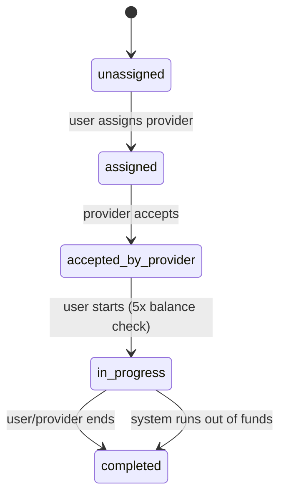
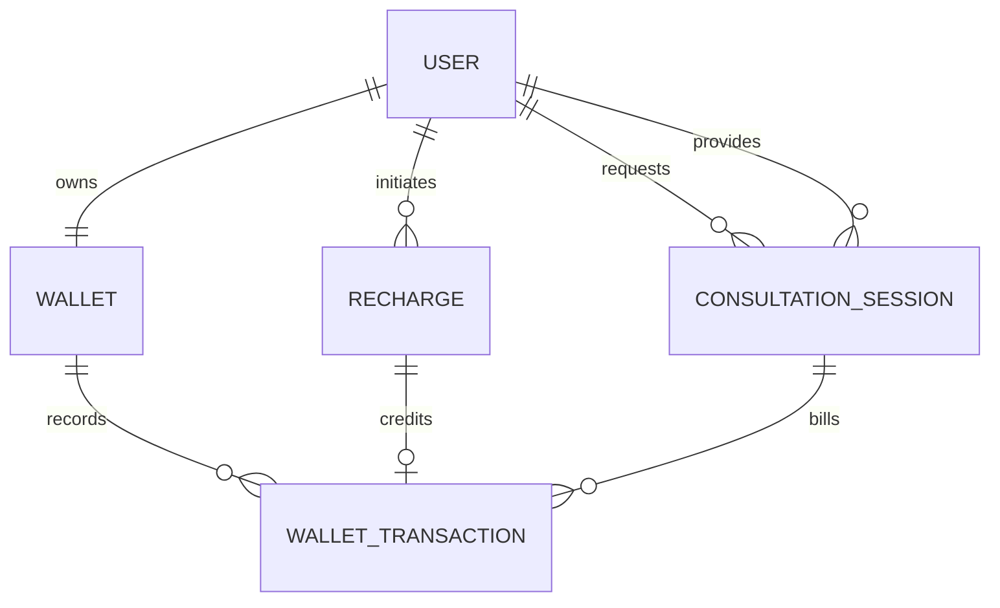

# Wallet-backed consultation sessions

A Django REST Framework API for prepaid wallet recharges and one-to-one sessions billed in whole minutes. SQLite is the local default; PostgreSQL can be selected through environment variables.

## Requirements and setup

- Python 3.9+
- Dependencies in `requirements.txt`
- PostgreSQL is optional for local development

```powershell
py -m venv .venv
.\.venv\Scripts\Activate.ps1
pip install -r requirements.txt
python manage.py migrate
python manage.py runserver
```

The API starts at `http://127.0.0.1:8000/api/`. Create accounts at `POST /api/auth/register/` with `username`, `password` (at least 8 characters), and `role` (`USER` or `PROVIDER`). Obtain JWTs at `POST /api/auth/token/` using username and password.

For PostgreSQL, set `DB_ENGINE=postgres`, `DB_NAME`, `DB_USER`, `DB_PASSWORD`, `DB_HOST`, and `DB_PORT` before running migrations. Set `DJANGO_SECRET_KEY` and `DJANGO_DEBUG=0` in non-development deployments.

## Testing in the browsable API

The Django REST framework browsable API is available at the endpoints above when the development server is running. Open `/api/auth/register/` in a browser and use its HTML form to create a USER or PROVIDER account. To access protected endpoints in the browser, use the **Log in** link in the API navbar (or open `/api-auth/login/?next=/api/sessions/`) and sign in with that account. This creates a browser session for the browsable interface; JWT clients can continue to use `/api/auth/token/` and bearer tokens. Visit `/api/recharges/`, `/api/sessions/`, and other `/api/` routes to use their interactive forms. Session action endpoints are POST requests; use the HTML form where available or the browsable API's raw-data tab to submit JSON such as `{"provider_id": 2}` for assignment.

## API outline

Authenticated endpoints use `Authorization: Bearer <access-token>`.

| Method | Endpoint | Purpose |
| --- | --- | --- |
| POST | `/api/auth/register/` | Register a USER or PROVIDER account |
| POST | `/api/auth/token/` | Obtain JWT access and refresh tokens |
| GET | `/api/wallet/` | Read the signed-in user's balance |
| GET | `/api/wallet/transactions/` | List wallet credits and per-minute debits |
| GET, POST | `/api/recharges/` | List or initiate a mock recharge |
| POST | `/api/recharges/{reference}/callback/` | Mock payment callback (`status`: `success` or `failed`) |
| GET, POST | `/api/sessions/` | List own/provider sessions or create a session |
| POST | `/api/sessions/{id}/assign/` | Assign a provider to an unassigned session |
| POST | `/api/sessions/{id}/accept/` | Assigned provider accepts |
| POST | `/api/sessions/{id}/start/` | Session user starts an accepted session |
| POST | `/api/sessions/{id}/bill/` | Settle all elapsed whole minutes; safe to retry |
| POST | `/api/sessions/{id}/end/` | Settle elapsed minutes and end an active session |

Creating a session takes `cost_per_minute` and optional `provider_id`. The session's price cannot be changed after creation. A user needs a balance of at least five times the rate to start. A billing request charges only previously unbilled whole minutes. If the balance cannot cover the next elapsed minute, the session is completed with `end_reason` set to `system: Insufficient Balance`; `talk_time_seconds` records the elapsed duration at termination. The mock callback is intentionally public to simulate a payment provider and must not be used as-is for real payment processing.

## State and data model





Wallet balance is constrained non-negative in the database. Successful recharge callbacks are applied within a transaction and have one unique credit ledger entry per recharge. Session debits have a unique `(session, minute_number)` ledger key, and session `billed_minutes` is the checkpoint used to calculate the next charge. An active-session uniqueness constraint prevents a user from running concurrent sessions. PostgreSQL row locks protect the balance and session during settlements; SQLite is intended only for development/testing.

## Tests

```powershell
python manage.py test
```

The automated suite covers the minimum starting balance, full recharge/session/billing flow, automatic depletion, invalid transitions, and recharge/billing idempotency.

## Implementation note

Billing is synchronous when `/bill/` or `/end/` is called: it catches up all whole minutes elapsed since start, rather than depending on a worker or timer. Therefore, an integration must call the bill action periodically to enforce low-balance termination close to real time. Any unused fraction of a minute is not charged, and the precise elapsed seconds are retained when the session ends.
